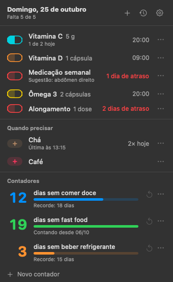

# Dose

Controle de remédios e suplementos pela barra de menus do macOS. Um clique na pílula mostra o que falta hoje, o que já foi tomado (e a que horas) e o que é "quando precisar".



O print usa itens de exemplo.

## Instalar

1. Baixe o `Dose-x.y.z.dmg` (ou o `.zip`) na [página de releases](https://github.com/yagoramires/dose/releases/latest) e arraste o **Dose.app** pra pasta **Aplicativos**.
2. Abra o Dose. Como ele não é assinado com um certificado pago da Apple, na primeira vez o macOS avisa que não conseguiu verificar o desenvolvedor. Clique com o botão direito no app → **Abrir**, ou vá em **Ajustes do Sistema → Privacidade e Segurança**, role até o fim e clique em **Abrir Mesmo Assim**. Pelo Terminal também resolve: `xattr -dr com.apple.quarantine /Applications/Dose.app`
3. Permita as notificações quando o macOS pedir (veja **Permissões**). Na primeira abertura o Dose entra sozinho nos itens de início, porque os lembretes só chegam com ele aberto.

Requer macOS 14 ou mais novo. Roda nativo em Apple Silicon e Intel. Também dá pra compilar do código (veja **Build local**).

### Pelo NeyHub

Quem usa o [NeyHub](https://github.com/yagoramires/neyhub) pode instalar o Dose pela Loja dele (o `Dose-x.y.z.neyplugin` do release). Aí o Dose roda dentro do NeyHub, com os mesmos dados do avulso (`dados.json`): a pílula e o popover são os mesmos, os lembretes chegam como NeyHub (a permissão de notificações é do NeyHub, pela tela **Permissões**), tocar num lembrete abre a tela do Dose na janela do NeyHub (em **Escolher local…**, já no registro do item; com o Dose só na barra de menus, abre o popover, como no avulso), o NeyHub cuida do login, das atualizações e de mostrar ou esconder a pílula, e o popover não tem **Abrir ao iniciar o Mac**, **Configurações…**, **Sair do Dose** nem a linha **Atualização pronta**. Feche o Dose avulso antes: se o NeyHub já roda o Dose, o avulso avisa (um aviso só), sai dos itens de login e fecha.

### Desinstalar

1. Em **Itens e ajustes** (a engrenagem), desligue **Abrir ao iniciar o Mac** e clique em **Sair do Dose**.
2. Apague o **Dose.app** de Aplicativos. Pelo NeyHub, é só desinstalar no card do Dose: os lembretes param na hora.
3. Os dados continuam em `~/Library/Application Support/Dose/`. Pra apagar tudo (sem volta): `rm -rf ~/Library/Application\ Support/Dose ~/Library/Logs/Dose; defaults delete local.dose`

## Permissões

- **Notificações**: para os lembretes (alerta e som). O macOS pede na primeira vez. Dentro do NeyHub a permissão é do NeyHub e se dá pela tela **Permissões** dele; o **Ligar** do aviso "Notificações desligadas" leva pra lá.
- Não pede Acessibilidade, Gravação de Tela, Câmera nem Microfone.

### Privacidade

Seus remédios, doses e contadores ficam só no seu Mac, em `~/Library/Application Support/Dose/dados.json`. A única conexão de rede é a consulta à API pública do GitHub (`api.github.com`) pra saber se tem versão nova, e o download dela. O log de depuração (`~/Library/Logs/Dose/dose.log`) também fica só no seu Mac.

## Como usar

Clique na pílula na barra de menus.

- Começa vazio: você adiciona e configura cada item (nome, dose, frequência, horários, cor).
- **Vários horários por dia** (08:00 e 20:00 = 2 doses): a cápsula enche a cada dose e o lembrete vem na hora de cada uma.
- **Todo dia** (vitamina C, vitamina D): marca com um clique, mostra a hora em que tomou e quantos dias seguidos.
- **Dias da semana** (só sábado, ou seg/qua/sex…) e **a cada N dias** (ômega 3 a cada 3 dias), contando da última dose.
- **Uma vez por semana** (Medicação semanal): dia fixo, avisa se atrasou e pede o **local da aplicação** num mapa do corpo (braço, abdômen, coxa; esquerdo e direito), sugerindo o local usado há mais tempo pro rodízio e mostrando onde foi a última aplicação. Tomar um dia antes também conta.
- **Quando precisar** (chá, café): só registra, com contagem do dia.
- **Contadores** ("12 dias sem comer doce"): dias desde a última vez e uma barra até o seu recorde. "+ Novo contador" no fim da seção, ↺ zera, ⋯ registra outra data ou desfaz.
- Clicar no nome de um item abre a edição dele; o + no topo cria um item novo.
- Cada item tem uma cor de cápsula, escolhida na edição; a cápsula vira o botão de marcar (meio cheia = falta, cheia com ✓ = tomado).
- **Lembretes**: no horário marcado, só se ainda não tomou. Insiste a cada 2 h (das 7 h às 23 h) até marcar. Dá pra marcar "Tomei" ou adiar 30 min direto na notificação.
- A pílula na barra mostra quantos itens ainda faltam hoje.
- Histórico com tudo o que foi registrado, dá pra apagar um registro errado ou registrar com outro horário.
- **Tela do Dose** (modo **Janela**, ou a tela do Dose dentro do NeyHub): o mesmo do popover, com espaço. Abas **Hoje** (agenda do dia com os atrasados no topo e depois por horário, os "quando precisar" como botões grandes, os contadores e a grade dos últimos 7 dias), **Histórico** (grade de 14 dias por item com a sequência atual, o rodízio de local e a lista de registros, onde dá pra apagar um) e **Itens** (a lista com o formulário de edição aberto ao lado). **+ Novo** cria um item; registrar com outro horário e novo contador abrem por cima. Na grade: verde-limão = completo, verde escuro = parcial, vermelho escuro = esquecido.
- **Itens e ajustes** (a engrenagem): lista dos itens, **Abrir ao iniciar o Mac**, **Abrir pasta dos dados**, **Configurações…** e **Sair do Dose**. Quando uma versão nova já foi baixada, aparece **Atualização pronta — entra ao sair**.

Os dados ficam em `~/Library/Application Support/Dose/dados.json` (o mesmo arquivo no avulso e no NeyHub) e o log em `~/Library/Logs/Dose/dose.log`.

## Atalhos

O Dose não tem atalho global. Nos formulários, Return confirma e Esc cancela. No modo **Janela**, `⌘,` abre as configurações e `⌘Q` fecha o Dose.

## Modos de exibição

O visual é o tema Grafite (escuro, com acento verde-limão), o mesmo do NeyHub. A pílula na barra mostra quantos itens ainda faltam hoje. Cada item tem uma cor de cápsula, escolhida na edição.

Em **Itens e ajustes → Configurações…** você escolhe onde o Dose aparece, e a troca vale na hora:

- **Barra de menus** (o padrão, como na 0.1.0): só a pílula.
- **Janela**: ícone no Dock e a tela do Dose. Clicar no ícone do Dock traz a janela de volta; o menu **Dose → Configurações…** (`⌘,`) abre as configurações.
- **Os dois**.

Desligar os dois não vale: o outro volta a ligar. Os lembretes chegam em qualquer modo, enquanto o Dose estiver aberto. Dentro do NeyHub o modo é escolhido no card do Dose, na Loja.

## Atualizações

Desde a 0.2.0, o Dose confere 5 s depois de abrir e a cada 6 h se tem versão nova, baixa sozinho e só troca o app quando você fecha o Dose: nunca reinicia no meio do uso. Na próxima abertura, mostra uma vez a janela **Novidades** com o que mudou. A versão baixada só é instalada se tiver sido assinada pelo mesmo certificado do app em uso, então a permissão de notificações continua valendo. Dentro do NeyHub, quem atualiza é o NeyHub.

Quem está na 0.1.0 precisa instalar a 0.2.0 uma vez à mão (ela ainda não tinha atualização automática). Os dados ficam onde estão.

## Build local

### Compilar

Só precisa das Command Line Tools (`xcode-select --install`), não do Xcode.

```sh
git clone https://github.com/yagoramires/dose.git && cd dose
scripts/setup-signing.sh   # uma vez: certificado local de assinatura (veja abaixo)
scripts/build.sh --run     # gera build/Dose.app e abre (fecha o Dose aberto antes)
scripts/selftest.sh        # testes; imprime "selftest ok"
```

O NeyKit (tema Grafite, `@ViewState`, contrato de plugin) e o NeyKitApp (atualização, novidades) vêm do checkout do
[neyhub](https://github.com/yagoramires/neyhub) ao lado (`../neyhub`); para outro lugar, defina `NEYHUB_PATH`.

O `setup-signing.sh` cria um certificado de assinatura local ("Aero Local Signing", o mesmo do Aero) no seu Chaveiro. A permissão de notificações e o item de login ficam presos à assinatura do app: com assinatura ad-hoc ela muda a cada build e o macOS para de confiar no app. Sem o certificado o build falha: o NeyHub só carrega plugins e as atualizações só entram com essa assinatura.

`build/Dose.app/Contents/MacOS/Dose --snapshots <pasta>` desenha cada tela em PNG com dados de exemplo, sem tocar nos dados de verdade.

> O SDK atual transformou `@State` num macro cujo plugin só vem com o Xcode; as telas usam o `@ViewState` do NeyKit, que faz a mesma coisa.

### Como funciona

O miolo fica em `Sources/DoseCore` e é o mesmo no app avulso e no plugin do NeyHub:

| Arquivo | Papel |
| --- | --- |
| `DoseApp.swift` | Pílula e popover da barra, modos de exibição, configurações e `stop()` (desinstalar no NeyHub). Recebe os `UserDefaults`, se está hospedado e a versão. |
| `Store.swift`, `Model.swift` | Itens e doses em `~/Library/Application Support/Dose/dados.json`. |
| `Reminders.swift` | Lembretes. Avisos e categorias com o prefixo `local.dose.`, que o NeyHub usa pra entregar a resposta ao Dose. Dentro do NeyHub não pede a permissão nem vira delegate das notificações (é o NeyHub que faz). |
| `Views/` | O popover e a tela de app (`ScreenView.swift`, que reaproveita as linhas e os formulários do popover), em SwiftUI no tema Grafite do NeyKit. |
| `SettingsView.swift` | Configurações (janela do avulso e card no NeyHub). |
| `Log.swift`, `Format.swift` | Log de depuração com rotação e formatação de datas. |
| `SelfTest.swift` | `--selftest` (rode com `scripts/selftest.sh`). Usa arquivo temporário e um centro de notificações falso. |
| `Snapshots.swift` | `Dose --snapshots <pasta>`. |

As cascas: `Sources/Dose` (app avulso: confere se o NeyHub já roda o Dose, atualização e novidades do NeyKitApp) e `Sources/DosePlugin` (o `libDosePlugin.dylib` que o NeyHub carrega; linka só o NeyKit). O `Info.plist` declara `NeyHubAware = true` porque o avulso chama `HubCheck.leaveForHub` ao abrir: com essa chave o NeyHub não mostra o alerta dele quando o avulso abre (só declare em app que faz essa checagem).

### Publicar uma versão

1. Suba a versão em `Resources/Info.plist` (`CFBundleShortVersionString` e `CFBundleVersion`) e escreva a seção `## [x.y.z]` do `CHANGELOG.md` (vira a nota do release e a janela Novidades).
2. `scripts/release.sh` gera em `dist/` o `Dose-x.y.z.dmg`, o `Dose-x.y.z.zip` (o app, que a atualização automática baixa) e o `Dose-x.y.z.neyplugin` (o plugin do NeyHub). Só empacota.
3. Commit, push e `NEYHUB_CONFIRM_PUBLISH=yes scripts/release.sh --publish` para criar o release.

O release **precisa ser assinado com o mesmo certificado** das versões anteriores, senão os apps já instalados recusam a atualização automática.

## Patch notes

Veja o [CHANGELOG](CHANGELOG.md).

## Licença

[MIT](LICENSE)
